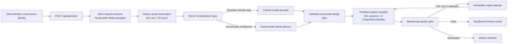

# DesignOS Studio MVP

DesignOS Studio turns a product brief into an animated HTML prototype using one of 201 production-certified design systems, and keeps the artifact hidden until every required mechanical gate passes. The browser never accepts an Anthropic, OpenAI, Google, or compatible provider key.

P0 includes a Sites-identity-aware, D1-backed control plane. With no operator provider configured, local development uses a labelled deterministic planner and an in-memory test store; deployed Sites uses the `DB` binding for projects, runs, idempotency, quota and cost records.

## Architecture



Provider credentials exist only in the server runtime. `DESIGNOS_PROVIDERS_JSON` accepts an ordered provider list; three consecutive failures open that provider's circuit for 30 seconds and the router tries the next provider:

- `DESIGNOS_PROVIDER_BASE_URL`: public HTTPS origin for an OpenAI-compatible gateway
- `DESIGNOS_PROVIDER_API_KEY`: operator-owned bearer secret
- `DESIGNOS_PROVIDER_MODEL`: operator-selected model identifier
- `DESIGNOS_PROVIDERS_JSON`: preferred multi-provider configuration, including optional input/output token prices

The request schema accepts only `brief`, `systemId`, and `variation`. Client-controlled `apiKey`, `providerKey`, `baseUrl`, `provider`, and `model` fields are rejected before quota reservation or provider access. Private, loopback, and non-HTTPS provider origins are rejected.

## What the MVP proves

- 201 certified design systems in the product picker: the provenance-preserved imported catalog, Kiln, and 48 original P2 systems.
- Three art-directed composition families per system, with system-specific ordering: `editorial-ledger`, `split-proof`, and `rail-story`.
- Twelve authored scene directions selected by an inspectable six-candidate tournament, spanning WebGL fields, spatial orbit, particles, SVG morph, signal trace, and kinetic type.
- Four distinct motion roles in every revealed artifact: arrival, scroll reveal, interaction feedback, and state/page transition.
- A maximum-three-attempt repair loop with artifact fingerprints. A failed draft is never returned as a preview.
- Six ≥95 mechanical checks: motion richness, authored renderer authenticity, typography hierarchy, spacing/rhythm, selected-system consistency, and first-view structure.
- A sandboxed, CSP-isolated HTML preview with no network, form, popup, or same-origin authority.
- Responsive Studio states, including a single-surface mobile focus-preview mode.

The numeric gate is an automated floor, not a human design score. The final seven-dimension design score remains `NOT_ASSESSED`.

## Run locally

Requirements: Node.js 22.13 or newer.

```bash
cd studio
npm install
npm run dev
```

Open `http://127.0.0.1:3000`, choose any certified system, enter a 24–640 character brief, and generate. The three direction cards follow that system's art-direction order.

Verification:

```bash
npm run lint
npm test
```

`npm test` performs a production build and verifies SSR, hidden repair/reveal, all three composition families, the twelve-scene/six-engine catalog, provider-field rejection, and invalid-brief withholding. `npm run test:motion-browser` mounts every renderer family in Chromium and verifies reduced-motion fallback.

## Gate and repair contract

1. Validate and normalize the brief.
2. Reserve quota before any model call.
3. Ask the central provider for a bounded JSON design plan; never accept generated HTML, CSS, JavaScript, URLs, or Markdown.
4. Compile the plan through the trusted system boundary, applying only the selected certified token contract and its licensed composition order.
5. Score the compiled artifact mechanically.
6. If any required check is below 95, retain only the attempt fingerprint and repair reason, then recompile.
7. Reveal only when all required checks pass; otherwise return `artifact: null` with `WITHHELD`.

The deterministic demo intentionally fails its first attempt by omitting one motion role. The second attempt restores the missing contract, proving that failed drafts remain hidden and that repair changes the artifact fingerprint.

## Security and cost controls

- Provider secrets are server-only environment variables and are never serialized to the client.
- The gateway accepts structured plan data only; the trusted compiler owns executable output.
- Generated documents have a restrictive CSP (`default-src 'none'`) and no outbound connections.
- The preview iframe uses `sandbox="allow-scripts"` without same-origin, forms, navigation, downloads, or popups.
- Each idempotent request has at most one planning call and three local compile/gate attempts.
- D1 atomically enforces the configured daily run limit and records token/cost usage.
- Project ownership is checked server-side; another user receives 404 rather than project metadata.

The isolated browser/render worker protocol is implemented and locally verified. Production worker provisioning, operator provider secrets, physical mid-range device evidence, and live-provider cost evidence remain operational boundaries and are not claimed until provisioned.

## Evidence

- `studio/evidence/browser-gate.json`: final 22-scenario browser gate, keyboard tasks, accessibility tree, Axe, forced colors, text spacing/zoom, and motion modes
- `studio/evidence/browser-gate.initial.json`: preserved first failing run; the repair history is not hidden
- `studio/evidence/lighthouse.json`: Lighthouse evidence
- `studio/evidence/generated-desktop.png` and `studio/evidence/generated-mobile.png`: closing visual states
- `studio/evidence/scorecard.md`: claims, limitations, blind-review disposition, and final assessment status

## Project map

- `studio/app/studio-shell.tsx`: Studio state machine and reveal UI
- `studio/app/api/generate/route.ts`: request boundary, rejection policy, quota, and cost metadata
- `studio/lib/studio-pipeline.ts`: planner, multi-system compiler, gate, repair loop, and artifact isolation
- `studio/tests/studio.test.mjs`: end-to-end contract tests
- `studio/.openai/hosting.json`: Sites deployment configuration

## P2 scope boundary

The repository now contains 201 certified systems, three composition contracts per system, durable multi-tenant billing/quota records, provider failover, an isolated signed artifact worker protocol, and tested 25-agent distribution adapters. Operator provisioning, production worker deployment, live-provider cost evidence, and deployment SLO evidence remain operational—not implementation—claims and are not marked assessed here.
