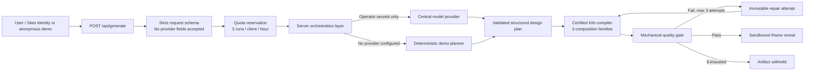

# DesignOS Studio MVP

DesignOS Studio turns a product brief into a Kiln-conformant, animated HTML prototype and keeps the artifact hidden until every required mechanical gate passes. The browser never accepts an Anthropic, OpenAI, Google, or compatible provider key.

This is an end-to-end MVP, not the production control plane. With no operator provider variables configured, the same pipeline runs through a clearly labelled deterministic demo planner. The compiler, repair loop, reveal policy, sandbox, quota boundary, and evidence flow are identical.

## Architecture



Provider credentials exist only in the server runtime:

- `DESIGNOS_PROVIDER_BASE_URL`: public HTTPS origin for an OpenAI-compatible gateway
- `DESIGNOS_PROVIDER_API_KEY`: operator-owned bearer secret
- `DESIGNOS_PROVIDER_MODEL`: operator-selected model identifier

The request schema accepts only `brief`, `systemId`, and `variation`. Client-controlled `apiKey`, `providerKey`, `baseUrl`, `provider`, and `model` fields are rejected before quota reservation or provider access. Private, loopback, and non-HTTPS provider origins are rejected.

## What the MVP proves

- One certified design system: Kiln. The wider 153-package catalog remains outside the product picker until prose-to-token integrity issues are resolved.
- Three deterministic composition families: `editorial-ledger`, `split-proof`, and `rail-story`.
- Four distinct motion roles in every revealed artifact: arrival, scroll reveal, interaction feedback, and state/page transition.
- A maximum-three-attempt repair loop with artifact fingerprints. A failed draft is never returned as a preview.
- Five ≥95 mechanical checks: motion richness, typography hierarchy, spacing/rhythm, Kiln consistency, and first-view structure.
- A sandboxed, CSP-isolated HTML preview with no network, form, popup, or same-origin authority.
- Responsive Studio states, including a single-surface mobile focus-preview mode.

The numeric gate is an automated floor, not a human design score. The final seven-dimension design score remains `NOT_ASSESSED`.

## Run locally

Requirements: Node.js 22.13 or newer.

```bash
cd studio
npm install
npm run dev
```

Open `http://127.0.0.1:3000`, keep Kiln selected, enter a 24–640 character brief, and generate. Use “Generate another composition” to move through the three layout families.

Verification:

```bash
npm run lint
npm test
```

`npm test` performs a production build and verifies SSR, hidden repair/reveal, all three composition families, provider-field rejection, and invalid-brief withholding.

## Gate and repair contract

1. Validate and normalize the brief.
2. Reserve quota before any model call.
3. Ask the central provider for a bounded JSON design plan; never accept generated HTML, CSS, JavaScript, URLs, or Markdown.
4. Compile the plan with the trusted Kiln compiler.
5. Score the compiled artifact mechanically.
6. If any required check is below 95, retain only the attempt fingerprint and repair reason, then recompile.
7. Reveal only when all required checks pass; otherwise return `artifact: null` with `WITHHELD`.

The deterministic demo intentionally fails its first attempt by omitting one motion role. The second attempt restores the missing contract, proving that failed drafts remain hidden and that repair changes the artifact fingerprint.

## Security and cost controls

- Provider secrets are server-only environment variables and are never serialized to the client.
- The gateway accepts structured plan data only; the trusted compiler owns executable output.
- Generated documents have a restrictive CSP (`default-src 'none'`) and no outbound connections.
- The preview iframe uses `sandbox="allow-scripts"` without same-origin, forms, navigation, downloads, or popups.
- Each request has one planning call and at most three local compile/gate attempts.
- The demo quota is five accepted runs per client key per hour.

Production v1 must replace the in-memory, IP-derived quota map with authenticated, durable, distributed usage and cost ledgers; add provider failover/circuit breakers; and execute gate/render work in isolated workers. Those capabilities are intentionally not claimed by this MVP.

## Evidence

- `studio/evidence/browser-gate.json`: final 22-scenario browser gate, keyboard tasks, accessibility tree, Axe, forced colors, text spacing/zoom, and motion modes
- `studio/evidence/browser-gate.initial.json`: preserved first failing run; the repair history is not hidden
- `studio/evidence/lighthouse.json`: Lighthouse evidence
- `studio/evidence/generated-desktop.png` and `studio/evidence/generated-mobile.png`: closing visual states
- `studio/evidence/scorecard.md`: claims, limitations, blind-review disposition, and final assessment status

## Project map

- `studio/app/studio-shell.tsx`: Studio state machine and reveal UI
- `studio/app/api/generate/route.ts`: request boundary, rejection policy, quota, and cost metadata
- `studio/lib/studio-pipeline.ts`: planner, Kiln compiler, gate, repair loop, and artifact isolation
- `studio/tests/studio.test.mjs`: end-to-end contract tests
- `studio/.openai/hosting.json`: Sites deployment configuration

## Deferred scope

The 200+ certified system target, 3–5 composition families per brand, durable multi-tenant billing/quotas, live provider failover, isolated render workers, and tested 25+ coding-agent MCP distribution belong to v1/v2. Existing DesignOS system packages and agent adapters are inputs to that roadmap, not production-readiness claims for this MVP.
